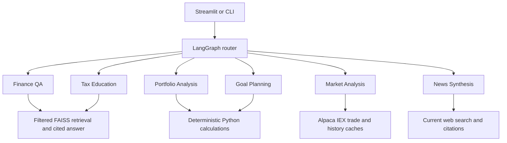

# Finnie — Personal Finance Agent

Public repository: [VipulW143/finnie-personal-finance-agent](https://github.com/VipulW143/finnie-personal-finance-agent).

An educational capstone with six LangGraph specialists: Finance Q&A, Portfolio Analysis, Market Analysis, Goal Planning, News Synthesis, and Tax Education. A Streamlit interface combines conversation, cited source retrieval, deterministic calculations, and Alpaca IEX data.

## Start here

Use the extracted **source folder**, not a wheel. Editable installation keeps the article library, sample data, and evaluation files next to the installed code.

Tested environment: macOS arm64, Python **3.14.5**. The package declares Python 3.11+ as its code minimum; other Python/platform combinations have not been validated. Internet access is required to install dependencies. OpenAI access is needed for Chat, cited answers, query embeddings, and news search; Alpaca credentials enable actual market data.

```bash
python3 -m venv .venv
source .venv/bin/activate
python -m pip install -e '.[dev]'
cp .env.example .env
```

Edit `.env` locally. Supply your OpenAI key, an accessible model, and optionally both Alpaca values. Then start:

```bash
python -m streamlit run src/finnie/ui.py
```

For the tested third-party version snapshot on this Mac/Python combination, install `requirements-lock.txt` before the editable project:

```bash
python -m pip install -r requirements-lock.txt
python -m pip install -e '.[dev]'
```

`requirements.txt` is a convenience entry point for runtime installation (`python -m pip install -r requirements.txt`); dependency ranges remain in `pyproject.toml`. See [setup and troubleshooting](docs/setup.md).

## Architecture overview



The router can also plan two or three independent tasks, dispatched sequentially with results combined. Conversation history stays in session memory. See [technical design](docs/technical-design.md) for state contracts, cache lifecycle and limitations.

## Configuration

| Variable | Purpose |
| --- | --- |
| `OPENAI_API_KEY` | Your local API key; never include it in a submission |
| `FINNIE_MODEL` | Model used for answers, routing, and news; default `gpt-4o-mini`, subject to account/tool access |
| `OPENAI_EMBEDDING_MODEL` | Source/query embedding model; default `text-embedding-3-small` |
| `APCA_API_KEY_ID`, `APCA_API_SECRET_KEY` | Both are needed for actual Alpaca IEX requests |
| `FINNIE_ENV` | Display label, such as `learning` |
| `FINNIE_PROVIDER` | Display label; the implemented model integration uses OpenAI |

Setting `FINNIE_PROVIDER=demo` does not disable API calls or select another backend. Process environment values take precedence over `.env`. Never share `.env`; `.env.example` has blank credential fields.

## What to try

| View | Example / expected behavior |
| --- | --- |
| Chat | “Explain compounding in investing.” Routes automatically and cites captured sources. |
| Finance Q&A | Select a topic and ask about it; the category filters sources before search. |
| Portfolio | Upload `samples/portfolio.csv`; expect $1,466 total, $0.44 estimated annual expenses, position/class allocation charts. |
| Goals | Target 20000, saved 5000, five years, nominal return 5%; expect $199.74 monthly and $20,000.33 projected. |
| Market | AAPL or TSLA, 90 calendar days; latest trade plus daily-close/SMA chart when history is available. |
| News | Ask for recent U.S. mutual-fund or Federal Reserve news; inspect actual citation dates and links. |
| Tax Education | “Explain traditional IRA vs Roth IRA.” General IRS-backed education; no personal tax bill calculation. |
| Knowledge | Browse 50 captured summaries and 26 cited glossary terms; try APR or compound. |

Multi-agent example in Chat:

> Explain compounding in investing, and separately calculate the monthly contribution for a target of 20000 with 5000 saved over five years at an assumed 5% nominal annual return.

Expect `multi_agent` with separate educational and goal-planning sections. Requests support up to three independent tasks, executed sequentially. Dependent plans ask for clarification.

For a goal without inputs, Finnie asks for target, current savings, whole-year horizon, and assumed return. Low/high comfort with losses changes educational context, not the entered rate or calculation. No expected return is chosen for the user.

## Tests, evaluation, and performance

```bash
python scripts/check_quality.py
python scripts/evaluate_project.py
```

The first command runs the offline suite and enforces 80% combined statement/branch coverage across all production source files. It writes JSON and HTML to `reports/`. The benchmark command makes no API calls and uses only an already-current saved index; without one it reports unavailable FAISS measurements. Calculation benchmarks still run.

Optional live evaluation, which uses the configured API and incurs usage:

```bash
python scripts/evaluate_project.py --live --answers
```

Retained development evidence is in `evaluation/results.json`: 12/12 retrieval questions found all designated relevant documents and 10/10 router cases passed after fixing a missing-input defaulting defect. Three answer samples were compared with captured sources; citation placement remains imperfect. These are small development checks, not independent/held-out accuracy estimates. Local microbenchmarks are not end-to-end latency or load/throughput claims.

Current verification: **97 tests pass**, with **96.53% combined coverage**. Installation from the source ZIP, dependency consistency, CLI startup, and headless Streamlit passed in a disposable Python 3.14.5 environment. The latest coverage and packaged-install verification are recorded in [submission verification](docs/submission-verification.md). [Evaluation details](docs/acceptance-and-performance.md) explain the initial failure, correction, timings, and limitations.

## Data, calculation, and fallback behavior

- Knowledge articles are **selected educational summaries of 50 distinct sources**, not complete downloaded originals. Files and citations are mapped in `articles/sources.json`. The glossary is not counted toward the 50-source minimum.
- The first source-answer request builds `.finnie/knowledge_index.json` using the embedding API. Later loads reuse the cache while article text/metadata and the embedding model are unchanged. Cache files are deliberately absent from the submission ZIP.
- FAISS uses normalized vectors and exact inner-product search. The embedding model must match for source and question vectors. Changing it invalidates the saved index.
- Portfolio prices/labels are user supplied. CSV/CLI expense ratios are fractions (`0.0003` means `0.03%`); manual form ratios are percentages (`0.03` means `0.03%`). Repeated symbols combine for concentration, and missing classes remain UNKNOWN. No fund look-through or historical portfolio risk estimate is claimed.
- Goals divide nominal annual return by 12, compound monthly, and contribute at each month end. Contributions round upward to cents. A 0% comparison uses the same contribution and is not a guaranteed floor. Taxes, fees, inflation, and fluctuating returns are not modeled.
- Latest trades use an independent 30-minute cache; failures return labeled stale data or a **SIMULATED $100** fallback. Historical daily bars have their own 30-minute cache and stale fallback; absent history produces **no fabricated chart**. IEX is one exchange, not consolidated-market data. Daily bars are split-adjusted, exclude the current UTC date, and do not include dividend total return.
- Conversation/results are in memory. Clear conversation and results removes visible outputs, not all provider/index caches. Stopping the process resets market caches and sessions; the source index persists on disk.

Finnie supplies general education, not individualized investment or tax advice, guaranteed forecasts, or a suitability assessment. It does not place trades. The prototype is local; authentication, multi-user load testing, full numeric provenance, and production hosting controls are not implemented.

## Project layout

```text
src/finnie/       application, workflow, calculators, provider adapters, UI
articles/         50 source summaries, metadata, glossary
samples/          example portfolio CSV and goal JSON
tests/           offline unit and Streamlit AppTest checks
scripts/          quality, evaluation, packaging, and package validation
evaluation/      curated cases and retained development results
docs/            setup, design, API/usage, evidence, submission checks
```

## Demo video

Required recording: **5–10 minutes; pending recording/upload**. The actual video URL will be added here after upload. See the [8–9 minute recording guide with exact questions](docs/demo-video.md).

The required submission sequence is GitHub repository → record/upload demo → add its README link and push → download the final repository ZIP from GitHub → submit the form. The existing local ZIP is a verified checkpoint, not yet that GitHub download. See [GitHub and submission checklist](docs/github-submission.md).

## Documentation and submission

- [Setup and troubleshooting](docs/setup.md)
- [Technical design and data flow](docs/technical-design.md)
- [Python interface and CLI reference](docs/interfaces.md)
- [Submission verification and remaining manual checks](docs/submission-verification.md)
- [Source/routing/answer evaluation and performance](docs/acceptance-and-performance.md)
Other milestone documents retain earlier measurements; use submission verification for the latest totals.

- [Archived learning history](docs/learning-history.md) — earlier checkpoints, not current setup instructions

Build the source ZIP:

```bash
python scripts/build_submission.py
```

This writes `dist/finnie-submission.zip`, its SHA-256 checksum, and a per-file manifest inside the ZIP. An explicit allowlist excludes `.env`, `.venv`, caches, generated reports, build metadata, and course reference documents. Files are not published or uploaded. See the verification document for clean-install evidence and package limitations.

Current planning estimate: approximately **96% complete**, subject to the verification record. This is not a grade. Core implementation and automated checks are in place; final manual acceptance and the required 5–10 minute demo video remain. Docker and MCP are optional and are not implemented.
