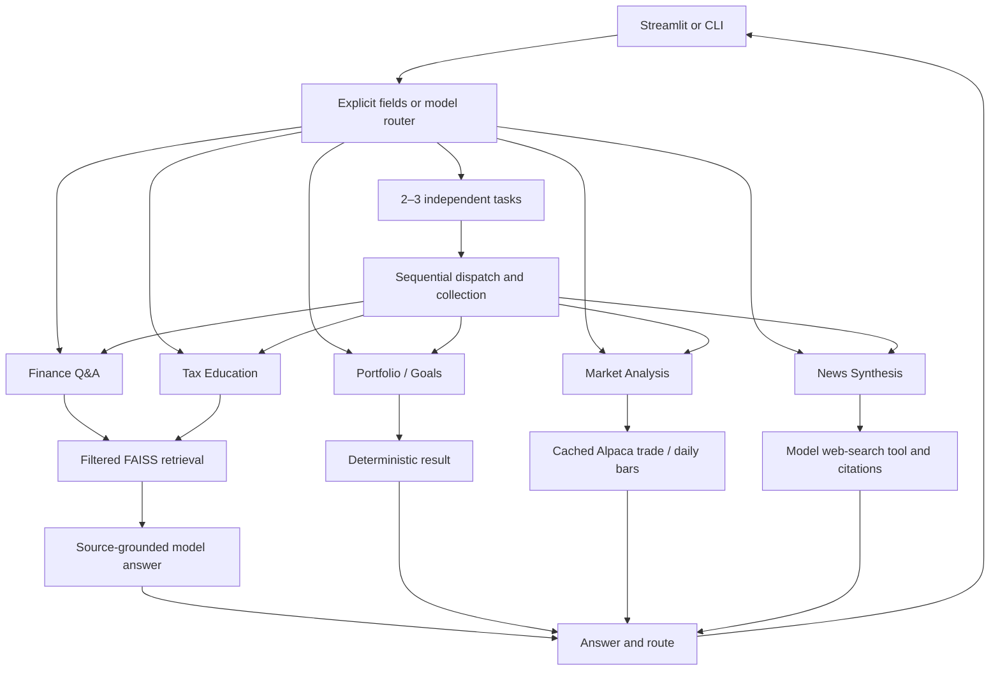

# Technical design

## Architecture and decisions

Finnie separates domain calculations, provider I/O, retrieval, orchestration, and rendering. Python keeps the learner's implementation local; LangGraph provides explicit specialist nodes and sequential plans; Streamlit provides forms/chat/charts; FAISS supplies exact cosine-equivalent search over a small library. OpenAI is the implemented model/embedding/search provider. Alpaca IEX replaced the suggested market providers at the learner's direction.

## Module responsibilities

| Modules | Responsibility |
| --- | --- |
| config.py | Source-root configuration, dotenv loading, secret accessors |
| app.py / ui.py / *_ui.py | CLI loop, shared session navigation, domain forms/charts |
| routing.py | JSON model plan validation, reference-context selection, retirement routing correction, goal-input clarification |
| workflow.py | LangGraph nodes, explicit quote/field routing, lazy index lifecycle, specialist dispatch and task result collection |
| knowledge.py / chunking.py | Source catalog/glossary access, topic grouping, paragraph-aware bounded chunks with metadata |
| embeddings.py / llm.py | Configured SDK calls; embedding order restored using response indices |
| vector_store.py / retrieval.py | Float32 normalization, FAISS IndexFlatIP, semantic ranking and metadata alignment |
| rag.py | Source fingerprint, atomic cache, category/IRS filtering, answer prompt, selected-source attribution, personal-tax boundary |
| portfolio.py / portfolio_import.py | Validated holdings, CSV parsing, value/fees/allocation/concentration |
| goals.py | Stable compound/annuity formulas, upward payment rounding, monthly paths and loss-comfort context |
| market_data.py / market_history.py | Provider validation, separate TTL caches, safe failure explanations, observed trend calculations |
| news.py | Search intent checks, current search prompt, provider annotations and source links; no fixed topic releases |

## Agent communication and state

This is one Python process, not six independent servers. Specialists communicate through the typed FinnieState dictionary and graph edges, not MCP/A2A/network messages. State carries the current question, explicit calculation/tool payload, optional history/category, route, answer, and optional plan/results.

Explicit trade wording and supplied tool fields route directly. Otherwise shared Chat uses resolve_request(). A standalone new topic does not automatically inherit old tax context. Reference wording forwards at most 12 turns, with content bounds, to resolve pronouns. This is a heuristic rather than full dialogue understanding.

For 2–3 independent tasks, validated task objects are dispatched one at a time. Each dispatch clears specialist-specific payloads. Results are collected in order, then combined with labeled sections. Dependent tasks, missing values, malformed plans, or excess task counts ask for clarification. There is no parallel worker pool or arbitrary autonomous execution.

Deterministic Goal/Portfolio form inputs bypass the model router. Calculators remain regular Python functions, avoiding model arithmetic. Goal context validation rejects missing fields and default numbers with no numerical user context; it is not complete field-by-field provenance verification.

## Retrieval and citations

The catalog maps 50 distinct source URLs to selected Markdown summaries. Every chunk carries title, URL, publisher, topic, and ID. Default chunk size is 1,000 characters, paragraph-aware with long-token splitting and no overlap. This is a character baseline, not a token-aware semantic splitter. The 26 glossary entries are separate UI data.

The configured embedding model produces vectors. FAISS normalizes float32 vectors and uses IndexFlatIP; normalized dot product equals cosine similarity. Exact search is sufficient for the measured 59-chunk library. Source metadata remains in corresponding row order. Category and IRS-only filters run before search, constructing a subset index from stored vectors without new source embeddings. Each ordinary question still needs a query embedding and answer call.

Cache version 2 stores native FAISS bytes as base64 plus chunks/vectors and a checksum. The fingerprint covers source text/metadata and embedding model. Writes use a unique temporary file and atomic replace. Valid legacy vectors can migrate without API calls; corrupt native bytes can reconstruct from valid vectors. Cache writes/validation are not a hostile-file sandbox. Saved vectors are duplicated for small-corpus recovery/subset construction.

Answers are instructed to use retrieved evidence. Displayed links correspond to cited chunk numbers and deduplicate URLs. History is conversation context, not source evidence. These mechanisms improve traceability but do not prove sentence-level entailment: unsupported prose or malformed citation references can still require review. Tax mode retrieves only IRS sources and declines a personal tax-bill calculation, including an explicit common 401(k) guard.

## Calculation models

Portfolio uses quantity × price, weighted allocation, known-fee coverage, and sum-of-squared-instrument-weights concentration. Duplicate symbols combine before concentration. User asset classes are separate from ETF structure. No holdings look-through, correlations, historical volatility, or suitability rating is inferred.

Goal planning solves the future-value annuity equation with nominal annual return/12 and month-end contributions. log1p/expm1 improve near-zero stability. Payment rounds upward to cents; the same value drives text and chart. The 0% comparison is not a downside floor. Loss comfort changes context, not the selected rate or investment strategy.

Market history requests 30/90/180 calendar days, excludes the current UTC date, and uses split-adjusted IEX bars. It reports endpoint price change (not dividend total return), SMA20 over observations, and observed closing-price drawdown inside the window. Missing dates are not filled; none of these is a forecast.

## Lifecycles, failures, and performance

| State | Lifetime / failure behavior |
| --- | --- |
| Chat and visible results | Per browser/CLI memory; clear callback resets displayed results |
| Compiled graph and lazy source index | Retained in a browser session; recreated on version change/restart |
| Source embeddings/index | Disk cache across restarts; source/model fingerprint invalidates it |
| Alpaca trade/history caches | Separate process-memory 30-minute caches, keyed by symbol/window where applicable |
| Provider failures | Readable errors; stale market data if available; labeled mock trade otherwise; no fabricated history |

API error messages avoid echoing secrets/request headers. SDK and HTTP errors are converted at domain boundaries. The implementation does not have a structured logging/telemetry backend or authenticated multi-tenant persistence. No production-scale or security certification is claimed.

Tests mock I/O and exercise the actual graph and UI layers separately. Live development cases and local timing snapshots are retained under evaluation/. Local FAISS timing excludes embeddings/model/network time. See acceptance-and-performance.md and submission-verification.md; the exact dependency snapshot and tested platform are documented rather than implying universal reproducibility.
